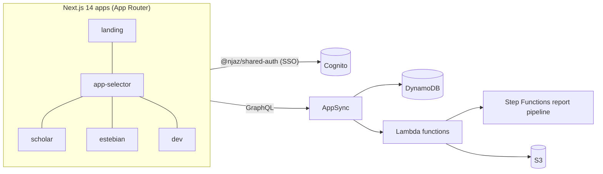

# Njaz Platform

**A TypeScript monorepo for academic research tooling: a research‑writing workspace (Scholar), a psychometric survey & statistics suite (Estebian), and a developer‑services portal, all on one shared AWS Amplify Gen2 backend with single sign‑on.**

Njaz (نجاز, "achievement") targets graduate students and researchers, especially Arabic‑speaking ones. The apps are RTL‑aware and bilingual (Arabic/English), and they cover the path from literature review to survey design, statistical analysis, and the final report.

---

## Applications

| App | Port | What it does |
| :-- | :-- | :-- |
| [`apps/scholar`](apps/scholar) | 3004 | Research‑writing workspace with a block‑based document editor (fractional indexing, drag‑and‑drop), literature search (OpenAlex), BibTeX/RIS/DOI citation import and de‑duplication, cross‑references, LaTeX→OMML equations, DOCX export and print preview, comments, and a project canvas (React Flow). |
| [`apps/estebian`](apps/estebian) | 3002 | Survey and psychometrics suite with a scale/survey builder, public response collection, an Excel import wizard with column/score mapping, reliability analysis (Cronbach's α, α‑if‑deleted, item‑total r), EFA, Sobel mediation on an interactive SEM path board, data‑cleaning heuristics, and an interactive Report Studio with PDF/CSV export. |
| [`apps/dev`](apps/dev) | 3003 | Developer‑services portal with an intake pipeline, a rules‑based pricing engine, a workflow/template generator, an admin dashboard, and Slack notifications. |
| [`apps/app-selector`](apps/app-selector) | 3001 | Cross‑product portal, app switcher, and user/group administration. |
| [`apps/landing`](apps/landing) | 3000 | Public marketing site and privacy policy. |

## Shared packages

| Package | Purpose |
| :-- | :-- |
| [`packages/shared-backend`](packages/shared-backend) | AWS Amplify Gen2 backend: Cognito auth, AppSync/DynamoDB data models split into per-domain schemas, S3 storage, and Lambda functions (`computeReport`, `analyzeData`, `simulationEngine`, `generateReportPdf`, `researchPipeline`, `submitResponse`, `manageUsers`, `verifyPayment`) orchestrated by a Step Functions report pipeline. |
| [`packages/shared-auth`](packages/shared-auth) | Cross‑subdomain SSO (cookie‑based token storage, environment‑prefixed isolation between `test` and `main`). |
| [`packages/ui-components`](packages/ui-components) | Shared design system ("Futuristic" theme, RTL‑aware). |
| [`packages/estebian-data`](packages/estebian-data) | Survey scale definitions and domain data. |
| [`packages/shared-assets`](packages/shared-assets) | Logos and images, synced into each app by `scripts/sync-assets.js`. |

## Architecture



- **Tooling:** npm workspaces + Turborepo, TypeScript, Tailwind CSS, Zustand, Vitest
- **Deployment:** AWS Amplify Hosting via [`amplify.yml`](amplify.yml). The backend app deploys first, then triggers the frontend apps. `main` is production and `test` is staging.

## Getting started

**Prerequisites:** Node.js 18+ and npm 10+. To run against a backend, you also need an AWS account with credentials configured.

```bash
npm install

# Start a personal Amplify sandbox backend. This writes
# packages/shared-backend/amplify_outputs.json
npm run amplify:sandbox

# Run all apps, or a single one
npm run dev
npm run dev:scholar

npm test     # unit tests (Vitest)
npm run lint
npm run build
```

`npm run dev` and `npm run build` first sync shared assets and copy `amplify_outputs.json` into every app (`scripts/sync-amplify-config.js`).

## Testing

Unit tests live next to the code they cover (`*.test.ts`) and run from the root with `npm test`. So far they cover the pure logic modules:

- `apps/estebian/src/lib/stats.ts`: descriptive stats, Pearson r, Cronbach's α, item analysis, reverse scoring, straight‑lining and pattern detection
- `apps/scholar/src/lib/fractional-index.ts`: block ordering and rebalancing
- `apps/scholar/src/lib/deduplication.ts`: reference de‑duplication by title/DOI

## Repository layout

```
apps/        Next.js applications
packages/    Shared backend, auth, UI, data, and assets
scripts/     Asset/config sync and maintenance scripts
docs/        Architecture notes and repository conventions
```

Conventions such as Conventional Commits, branch strategy, and file naming are documented in [`docs/BRANCH_STATUS.md`](docs/BRANCH_STATUS.md). Planned work is in [`ROADMAP.md`](ROADMAP.md).

## License

Proprietary. © Khaled Rashed. All rights reserved.
